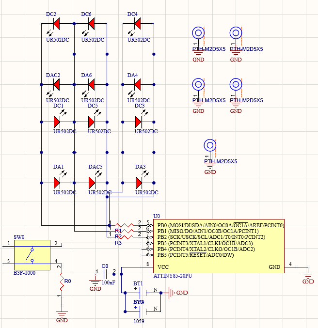
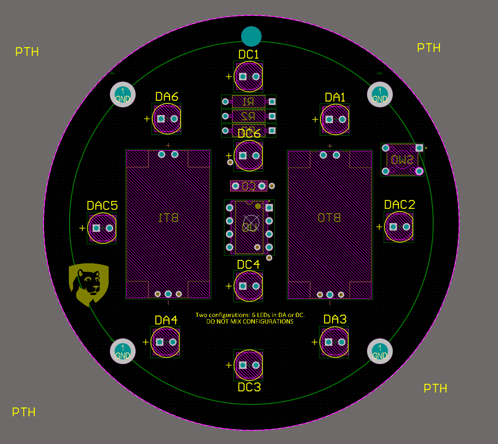

# Christmas Ornament PCB

A solderable LED ornament I designed for my university's IEEE student branch to use at a holiday soldering event. One 80 mm circular PCB supports **multiple front-plate designs** (wreath, mountain-and-stars, Bohr-model carbon atom). Each plate has its own LED layout, and students choose a theme, solder the LEDs for that layout, and screw on the matching 3D-printed plate.

| | |
|---|---|
|  |  |
| Schematic (Altium Designer) | PCB Layout (Altium Designer) |

> **TODO:** add `docs/images/assembled_lit.jpg`, `docs/images/pcb_front.jpg`, and a short GIF of each lighting mode.

## Highlights

- **Single PCB, multiple designs:** 12 LED footprints but only **3 MCU pins**. Each charlieplex address has two footprints (one per design region), so any plate layout works with the same firmware.
- **ATtiny85 at 1 MHz** on a coin cell, with peripherals disabled and a true **power-down off mode (~0.1 µA)**.
- **Four modes on one button:** all-on, organic fade, wreath shimmer, off. The last lit mode is saved in EEPROM.
- **Software PWM over charlieplexing:** 32 brightness levels per LED, and only one LED is ever on at a time, which keeps peak current low.
- **Parametric 3D-printed front plate:** a Python script turns the board's LED and screw coordinates into a watertight STL with light-tuned thickness, back-side light pockets, and through-hole "berries."

## Repository layout

```
├── docs/
│   ├── 01-design-decisions.md   Why charlieplexing, why ATtiny, power budget
│   ├── 02-hardware.md           Schematic notes, charlieplex table, BOM, mechanical
│   ├── 03-firmware.md           Architecture, modes, tuning knobs
│   ├── 04-front-plates.md       Plate options explored, light-transmission design
│   ├── 05-build-and-program.md  Assembly steps, flashing with a FabISP
│   ├── 06-lessons-learned.md    Bugs hit during bring-up and how they were fixed
│   └── images/
├── firmware/                    PlatformIO project (VS Code)
├── hardware/                    Altium sources, Gerbers, BOM (see hardware/README.md)
└── plates/                      STL files + Python generators
```

## Quick start

1. **Order the PCB** using the Gerbers in `hardware/gerbers/`.
2. **Assemble** following [docs/05-build-and-program.md](docs/05-build-and-program.md).
3. **Flash the firmware:** open `firmware/` in VS Code with PlatformIO, connect a USBtiny-compatible programmer (I used a FabISP), and click Upload.
4. **Print a front plate** from `plates/` (100% infill, 0.12 mm layers, face up).

## Status

| Item | Status |
|---|---|
| PCB rev A | Fabricated and working |
| Firmware (4 modes, sleep) | Working on hardware |
| Wreath plate | v4 generated, test print pending |
| Mountain and Bohr plates | Planned |
| Battery-life measurement | TODO (see power budget in docs/01) |

## Skills demonstrated

Schematic capture and PCB layout (Altium), low-power embedded C on bare AVR registers, charlieplex multiplexing, interrupt-driven input, hardware bring-up and debugging, DFM for hand assembly, parametric CAD in Python, and documenting it all for someone else to rebuild.

## License

Firmware and scripts: MIT (see `LICENSE`). Hardware design files: CC BY-SA 4.0.
