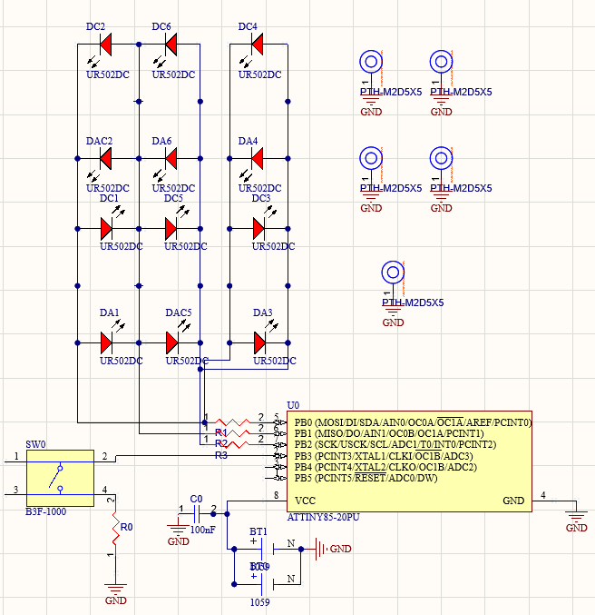

# 2. Hardware

## Overview
- 80 mm diameter circular PCB with a hanging tab at 12 o'clock
- ATtiny85-20PU (DIP-8)
- Coin cell holder (BT1) with a 100 nF decoupling cap (C0) on VCC
- 12 LED footprints (UR502DC, red) on 6 charlieplex addresses
- R1-R3: one series resistor per charlieplex pin
- SW0: B3F-1000 tactile switch on PB3, through R0 to GND (active low, internal pullup)
- 4 × M2.5 mounting holes for the front plate

## Pinout
| ATtiny85 pin | Port | Function |
|---|---|---|
| 5 | PB0 | Charlieplex line 0 (also ISP MOSI) |
| 6 | PB1 | Charlieplex line 1 (also ISP MISO) |
| 7 | PB2 | Charlieplex line 2 (also ISP SCK) |
| 2 | PB3 | Mode button |
| 1 | PB5 | RESET (ISP) |
| 8 / 4 | VCC / GND | Coin cell |

## Charlieplex address table
| LED | HIGH | LOW | Hi-Z |
|---|---|---|---|
| 0 | PB0 | PB1 | PB2 |
| 1 | PB1 | PB0 | PB2 |
| 2 | PB1 | PB2 | PB0 |
| 3 | PB2 | PB1 | PB0 |
| 4 | PB0 | PB2 | PB1 |
| 5 | PB2 | PB0 | PB1 |

## Mechanical coordinates (origin = board center, mm)
**Wreath LEDs:** (16.256, 19.939), (28.575, -0.762), (16.129, -22.987), (-16.383, -22.987), (-28.575, -1.016), (-16.129, 20.066)

**Mounting holes (M2.5):** (-25.781, 25.654), (-25.781, -25.781), (25.654, 25.654), (25.527, -25.781)

How the board center was recovered after the reference circle got deleted: I took three points on the board outline and intersected the perpendicular bisectors, which gave a radius of 39.944 mm that agreed from all three points.

## Bill of materials
| Ref | Part | Qty | Assembled by |
|---|---|---|---|
| U0 | ATtiny85-20PU | 1 | Pre-programmed |
| C0 | 100 nF ceramic | 1 | |
| R1-R3 | Charlieplex resistors, TODO value | 3 | |
| R0 | Button resistor, TODO value | 1 | |
| SW0 | Omron B3F-1000 | 1 | Student |
| D* | UR502DC red LED | 6 per design | Student |
| BT1 | Coin cell holder, TODO part | 1 | |
| — | M2.5 screws + standoffs | 4 | Student |

> **TODO:** export the full BOM from Altium to `hardware/bom.csv`.
